# VeriFi AI — Transaction-Authorization Layer

> **Real-time multimodal fraud interception correlating communication sensors (email/voice) with ERP payment requests via Neo4j Graph lineage, Amazon Bedrock, and FIDO2/WebAuthn Passkey step-up authentication.**

### 📚 Documentation Hub (`docs/`)
- 🏛️ **[System Architecture & Data Flow](file:///c:/Users/jayan/Desktop/VeriFi-AI/docs/SYSTEM_ARCHITECTURE.md)**: Full Mermaid blueprints, sequence diagrams, and Neo4j graph topologies.
- 🔌 **[API Documentation](file:///c:/Users/jayan/Desktop/VeriFi-AI/docs/API_DOCUMENTATION.md)**: Endpoints, request/response JSON schemas, and integration contracts.
- ⚙️ **[Setup & Deployment Guide](file:///c:/Users/jayan/Desktop/VeriFi-AI/docs/SETUP_GUIDE.md)**: Prerequisites, environment variables, Docker Neo4j, FastAPI & Next.js local setup.
- 🛡️ **[Security & Compliance](file:///c:/Users/jayan/Desktop/VeriFi-AI/docs/SECURITY_AND_COMPLIANCE.md)**: FIDO2 WebAuthn Passkeys, Presidio PII redaction, and SHA-256 evidence sealing.
- 🔄 **[Core Workflows](file:///c:/Users/jayan/Desktop/VeriFi-AI/docs/WORKFLOWS.md)**: Deep dive into the 4 business workflows and risk scoring math.

---

## 1. Project Overview

**VeriFi AI** sits between corporate communication channels (email, Zoom/telephony) and enterprise resource planning (ERP)/core banking platforms. Modern Business Email Compromise (BEC) and deepfake executive voice spoofing bypass traditional perimeter defenses because the payment execution happens legitimately inside ERP systems (SAP, Oracle, NetSuite).

VeriFi AI ingests incoming communication signals, analyzes intent and deepfake likelihood, constructs a dynamic temporal **Lineage Graph in Neo4j**, fuses contextual risk, and dynamically intercepts payments via a **FIDO2 WebAuthn Passkey Gate** before sealing tamper-evident audit trails into **AWS S3** with SHA-256 cryptographic hashes.

```mermaid
flowchart TB
    subgraph SENSORS ["1. Multimodal Communication Sensors"]
        direction TB
        E1["Corporate Email Ingress<br/>(Exchange / Gmail API)"]
        A1["Zoom / Telephony Bot Stream<br/>(Live Meeting Audio / SIP)"]
        
        E_PAYLOAD["Email Ingestion Payload<br/>• Headers: SPF, DKIM<br/>• Sender, Recipient<br/>• Subject, Raw Body"]
        A_PAYLOAD["Audio Ingestion Payload<br/>• Multipart .wav / .mp3<br/>• Caller Identity<br/>• Target Identity"]

        E1 --> E_PAYLOAD
        A1 --> A_PAYLOAD
    end

    subgraph BACKEND_AI ["2. AI & Sensing Pipeline (FastAPI / Bedrock / Wav2Vec2)"]
        direction TB
        EP_EMAIL["POST /api/v1/sensors/email"]
        EP_AUDIO["POST /api/v1/sensors/audio"]

        E_PAYLOAD -->|"JSON"| EP_EMAIL
        A_PAYLOAD -->|"multipart/form-data"| EP_AUDIO

        PII["PII Redaction Service (Presidio-aligned)<br/>• Masks IBAN: [REDACTED_IBAN]<br/>• Masks Cards: [REDACTED_CARD]<br/>• Masks Financial Sums: [REDACTED_AMOUNT]"]
        
        BEDROCK["Amazon Bedrock (Claude 3 Sonnet)<br/>anthropic.claude-3-sonnet-20240229-v1:0<br/>• Intent Categorization (wire_transfer_request)<br/>• Urgency Score (0.0 - 1.0)<br/>• Financial Action Detected (bool)<br/>• Secrecy Flag Detected (bool)"]
        
        WAV2VEC["HuggingFace Wav2Vec2 Classifier<br/>• Acoustic Phase Discontinuity<br/>• Pitch Jitter & Vocoder Artifacts<br/>• Deepfake Synthetic Probability (0.0 - 1.0)<br/>• Verdict: Authentic / Synthetic"]

        EP_EMAIL --> PII
        PII --> BEDROCK
        EP_AUDIO --> WAV2VEC
    end

    subgraph NEO4J_GRAPH ["3. Neo4j Temporal Lineage Graph"]
        direction TB
        NODE_USER["(:User)<br/>email, name, baseline_risk"]
        NODE_EMAIL["(:Email)<br/>event_id, spf_result, dkim_result,<br/>urgency_score, secrecy_flag, risk_score"]
        NODE_CALL["(:Call)<br/>event_id, caller, deepfake_score,<br/>duration_seconds, risk_score"]
        NODE_PAYMENT["(:Payment)<br/>transaction_id, amount, beneficiary,<br/>iban, risk_score, status"]

        REL_SENT["-[:SENT_TO]->"]
        REL_CALL["-[:CALLED]->"]
        REL_INIT["-[:INITIATED]->"]

        NODE_EMAIL --> REL_SENT --> NODE_USER
        NODE_CALL --> REL_CALL --> NODE_USER
        NODE_USER --> REL_INIT --> NODE_PAYMENT

        CYPHER_QUERY["Temporal Sliding Window Traversal<br/>MATCH (u:User {email: $email})<br/>OPTIONAL MATCH (e:Email)-[:SENT_TO]->(u)<br/>WHERE e.timestamp >= datetime($now - 72h)<br/>OPTIONAL MATCH (c:Call)-[:CALLED]->(u)<br/>WHERE c.timestamp >= datetime($now - 72h)<br/>RETURN emails, calls"]
    end

    BEDROCK -->|"Creates Email Node & Relationship"| NODE_EMAIL
    WAV2VEC -->|"Creates Call Node & Relationship"| NODE_CALL

    subgraph ERP_GATEWAY ["4. ERP Payment Gate & Risk Fusion Engine"]
        direction TB
        ERP_SRC["ERP Source Systems<br/>(SAP S/4HANA / Oracle NetSuite)"]
        
        EP_VERIFY["POST /api/v1/verify-transaction<br/>• transaction_id, requester_email<br/>• beneficiary_name, beneficiary_iban<br/>• amount, currency, reference"]
        
        ERP_SRC -->|"Payment Settlement Request"| EP_VERIFY

        FUSION_ENGINE["Risk Fusion Engine (Multi-Vector Scoring)<br/>1. Base Amount & Threshold Weighting<br/>2. Beneficiary Anomaly & Offshore IBAN Check<br/>3. 72h Lineage Graph Correlated Sensor Query<br/>4. Compounding Multimodal BEC + Voice Multiplier"]

        EP_VERIFY --> FUSION_ENGINE
        FUSION_ENGINE <-->|"Query 72h Sliding Window"| CYPHER_QUERY
        FUSION_ENGINE -->|"Creates / Updates Payment Node"| NODE_PAYMENT

        DECISION{"Composite Risk Score<br/>Evaluation"}
        FUSION_ENGINE --> DECISION

        BRANCH_PASS["Score < 30<br/>Status: PASS<br/>Nominal Risk Baseline"]
        BRANCH_STEPUP["Score 30 - 70<br/>Status: STEP-UP<br/>Challenge: fido2_passkey<br/>Session: auth_sess_id"]
        BRANCH_HOLD["Score > 70<br/>Status: HOLD<br/>Provable Fraud / BEC Correlation"]

        DECISION -->|"Risk < 30"| BRANCH_PASS
        DECISION -->|"30 <= Risk <= 70"| BRANCH_STEPUP
        DECISION -->|"Risk > 70"| BRANCH_HOLD
    end

    subgraph WEBAUTHN ["5. FIDO2 / WebAuthn Biometric Step-Up Gate"]
        direction TB
        EP_OPTIONS["POST /api/v1/passkey/generate-options<br/>• user_email, auth_session_id<br/>• Generates Random Challenge Token<br/>• rpId, timeout: 60000ms"]
        
        CLIENT_PROMPT["Frontend Passkey Prompt Modal<br/>(SimpleWebAuthn / Platform Authenticator)"]
        
        HARDWARE_AUTH["Hardware Security Authenticator<br/>• Apple Touch ID / Face ID<br/>• Windows Hello Biometrics<br/>• Physical YubiKey (FIDO2 NFC/USB)"]

        EP_VERIFY_PK["POST /api/v1/passkey/verify<br/>• Validates Public-Key Signature<br/>• Verifies Authenticator Data & User Presence"]

        BRANCH_STEPUP -->|"Trigger Step-Up"| EP_OPTIONS
        EP_OPTIONS --> CLIENT_PROMPT
        CLIENT_PROMPT <--> HARDWARE_AUTH
        CLIENT_PROMPT -->|"Credential Assertion"| EP_VERIFY_PK

        AUTH_RESULT{"Passkey Signature<br/>Valid?"}
        EP_VERIFY_PK --> AUTH_RESULT

        AUTH_SUCCESS["Biometric Verified<br/>Status transitioned to PASS<br/>Payment Released"]
        AUTH_DENIED["Verification Denied / Timeout<br/>Status transitioned to HOLD<br/>Transaction Quarantined"]

        AUTH_RESULT -->|"Signature Valid"| AUTH_SUCCESS
        AUTH_RESULT -->|"Failed / Rejected"| AUTH_DENIED
    end

    subgraph EVIDENCE_VAULT ["6. Cryptographic Evidence Sealing & Audit Vault"]
        direction TB
        CANONICAL["Canonical JSON Serializer<br/>• Alphabetical Key Sorting<br/>• Standardized ISO-8601 UTC Timestamps<br/>• Escaped Separators: ',', ':'"]
        
        SHA256["SHA-256 Digest Generator (hashlib)<br/>Produces Deterministic 64-character Hex Seal"]

        S3_VAULT["AWS S3 Evidence Vault (Boto3)<br/>Bucket: s3://verifi-evidence-vault/<br/>Key: evidence/{tx_id}_{status}.json<br/>Metadata: x-amz-meta-sha256"]

        LOCAL_VAULT["Local Vault Fallback<br/>(backend/evidence_vault/)"]

        BRANCH_HOLD -->|"Freeze & Seal"| CANONICAL
        AUTH_SUCCESS -->|"Authorize & Seal"| CANONICAL
        AUTH_DENIED -->|"Violation Seal"| CANONICAL

        CANONICAL --> SHA256
        SHA256 --> S3_VAULT
        S3_VAULT -.->|"Fallback if Offline"| LOCAL_VAULT
    end

    subgraph FRONTEND ["7. Frontend Portal (Next.js App Router / Tailwind CSS)"]
        direction TB
        PORTAL["VeriFi AI Unified Portal (page.tsx)"]

        VIEW_ERP["ERP Payment Gateway View<br/>• PaymentForm (Presets: $1.2k, $65k, $420k)<br/>• TransactionTable (Status Badges)"]
        
        VIEW_ANALYST["Fraud Analyst Command Center<br/>• LineageGraphView (Neo4j Visualizer)<br/>• RiskScoreMeter (Radial 0-100 Gauge)<br/>• EvidenceSealCard (SHA-256 Copy & S3 URI)"]
        
        VIEW_SENSORS["Multimodal Sensor Lab<br/>• Email Sensor Simulator (SPF/DKIM/Bedrock)<br/>• Zoom Audio Simulator (Wav2Vec2 Score)"]

        PORTAL --> VIEW_ERP
        PORTAL --> VIEW_ANALYST
        PORTAL --> VIEW_SENSORS
        PORTAL -.->|"Displays"| CLIENT_PROMPT

        S3_VAULT -->|"Inspect Evidence Artifacts"| VIEW_ANALYST
        NEO4J_GRAPH -->|"GET /api/v1/audit/lineage/{id}"| VIEW_ANALYST
        BRANCH_PASS -->|"Authorized Settlement"| VIEW_ERP
        AUTH_SUCCESS -->|"Released Settlement"| VIEW_ERP
    end

    classDef sensorStyle fill:#1e293b,stroke:#f59e0b,stroke-width:2px,color:#f8fafc;
    classDef aiStyle fill:#0f172a,stroke:#38bdf8,stroke-width:2px,color:#f8fafc;
    classDef graphStyle fill:#1e1b4b,stroke:#818cf8,stroke-width:2px,color:#f8fafc;
    classDef erpStyle fill:#0f172a,stroke:#10b981,stroke-width:2px,color:#f8fafc;
    classDef authStyle fill:#292524,stroke:#eab308,stroke-width:2px,color:#f8fafc;
    classDef vaultStyle fill:#111827,stroke:#ec4899,stroke-width:2px,color:#f8fafc;
    classDef frontStyle fill:#090d16,stroke:#06b6d4,stroke-width:2px,color:#f8fafc;

    class SENSORS sensorStyle;
    class BACKEND_AI aiStyle;
    class NEO4J_GRAPH graphStyle;
    class ERP_GATEWAY erpStyle;
    class WEBAUTHN authStyle;
    class EVIDENCE_VAULT vaultStyle;
    class FRONTEND frontStyle;
```



---

## 2. Architecture & Core Workflows

### Workflow 1: Sensor Ingestion & AI Processing
1. **Email Ingestion**: Ingests email raw metadata (Headers: SPF, DKIM, Sender, Subject, Body).
2. **Audio Ingestion**: Ingests recorded call segments (simulating Zoom bot streams).
3. **PII Masking**: Redacts sensitive personal and financial identifiers prior to cloud model inference.
4. **Bedrock Intent Extraction**: Amazon Bedrock (`anthropic.claude-3-sonnet-20240229-v1:0`) parses redacted text into structured risk vectors:
   - `intent`: `"wire_transfer_request" | "invoice_update" | "routine_communication"`
   - `urgency_score`: `0.0 - 1.0`
   - `financial_action_detected`: `boolean`
   - `secrecy_detected`: `boolean`
5. **Deepfake Audio Scoring**: HuggingFace Wav2Vec2 acoustic artifact classifier scores synthetic audio indicators (`0.0 - 1.0`).

### Workflow 2: Lineage Graph (Neo4j Temporal Correlation)
- Events create interconnected graph nodes: `(:User)`, `(:Email)`, `(:Call)`, `(:Payment)`.
- When a `Payment` node is evaluated, a Cypher graph query traverses outgoing/incoming edges within a **72-hour window**:
  - Unauthenticated email origins (Failed SPF/DKIM).
  - High urgency / confidential wire demands.
  - Deepfake audio indicators in recent voice interactions with the beneficiary or requester.

### Workflow 3: Payment Gate & Risk Fusion
Exposes `POST /api/v1/verify-transaction` for the ERP system:
- **Score < 30 (Low Risk)**: `status: "pass"` — Transaction proceeds automatically.
- **Score 30 - 70 (Medium Risk)**: `status: "step-up"` — Triggers hardware-bound FIDO2 WebAuthn Passkey biometric authentication.
- **Score > 70 (High Risk)**: `status: "hold"` — Transaction halted, flagged for analyst investigation.

### Workflow 4: Evidence Sealing & Audit Logging
- When an action is held or a passkey challenge fails/times out, a deterministic JSON audit manifest is assembled.
- An immutable **SHA-256 hash** seals the payload.
- Evidence envelope is uploaded to **AWS S3** under `evidence/{transaction_id}_{timestamp}.json`.
- Streamed in real-time to the **Next.js Fraud Analyst Dashboard**.

---

## 3. Directory Structure

```
VeriFi-AI/
├── README.md
├── backend/
│   ├── app/
│   │   ├── __init__.py
│   │   ├── main.py                  # FastAPI application entrypoint
│   │   ├── config.py                # Environment configuration & constants
│   │   ├── api/
│   │   │   ├── __init__.py
│   │   │   └── v1/
│   │   │       ├── __init__.py
│   │   │       ├── sensors.py       # Ingestion: /email, /audio
│   │   │       ├── verification.py  # Gatekeeper: /verify-transaction
│   │   │       ├── passkey.py       # WebAuthn options & verification
│   │   │       └── audit.py         # Evidence retrieval & analyst views
│   │   ├── core/
│   │   │   ├── __init__.py
│   │   │   ├── neo4j_connector.py   # Driver lifecycle & graph session handlers
│   │   │   ├── bedrock_client.py    # Amazon Bedrock Boto3 integration
│   │   │   ├── s3_client.py         # AWS S3 evidence archival
│   │   │   └── security.py          # SHA-256 evidence sealing utility
│   │   ├── services/
│   │   │   ├── __init__.py
│   │   │   ├── pii_redactor.py      # Presidio/regex PII redaction service
│   │   │   ├── intent_extractor.py  # Claude 3 structured JSON parser
│   │   │   ├── deepfake_scorer.py   # Audio Wav2Vec2 inference service
│   │   │   ├── lineage_graph.py     # Cypher queries & temporal correlation
│   │   │   └── risk_fusion_engine.py# Composite multi-factor risk scoring
│   │   └── models/
│   │       ├── __init__.py
│   │       ├── schemas.py           # Pydantic request/response models
│   │       └── graph_entities.py    # Neo4j node/edge schemas
│   ├── tests/
│   │   ├── __init__.py
│   │   ├── test_sensors.py
│   │   └── test_risk_fusion.py
│   ├── requirements.txt
│   └── .env.example
├── frontend/
│   ├── src/
│   │   ├── app/
│   │   │   ├── layout.tsx
│   │   │   ├── page.tsx             # Main portal (Hero & Navigation)
│   │   │   ├── erp-mock/
│   │   │   │   └── page.tsx         # Mock ERP Payment Trigger Dashboard
│   │   │   └── analyst/
│   │   │       └── page.tsx         # Fraud Analyst Lineage & Audit Dashboard
│   │   ├── components/
│   │   │   ├── ui/                  # Reusable shadcn/ui components (Card, Button, Badge, Dialog)
│   │   │   ├── erp/
│   │   │   │   ├── PaymentForm.tsx
│   │   │   │   └── TransactionTable.tsx
│   │   │   ├── analyst/
│   │   │   │   ├── LineageGraphView.tsx
│   │   │   │   ├── RiskScoreMeter.tsx
│   │   │   │   └── EvidenceSealCard.tsx
│   │   │   └── auth/
│   │   │       └── PasskeyPrompt.tsx # FIDO2 WebAuthn biometric modal
│   │   ├── hooks/
│   │   │   ├── useWebAuthn.ts       # SimpleWebAuthn browser client hook
│   │   │   └── useTransactions.ts
│   │   ├── lib/
│   │   │   ├── api.ts               # Backend REST API client
│   │   │   └── utils.ts
│   │   └── types/
│   │       └── index.ts
│   ├── package.json
│   ├── tailwind.config.ts
│   ├── tsconfig.json
│   └── .env.example
```

---

## 4. Prerequisites & Environment Variables

### Prerequisites
- Python 3.10+
- Node.js 18.x or 20.x
- Neo4j 5.x (Local instance or Neo4j AuraDB instance)
- AWS Account with Bedrock Claude 3 model access & an S3 Bucket (or local mock mode enabled)

### Backend Environment Variables (`backend/.env.example`)
```env
# Server
ENVIRONMENT=development
PORT=8000
HOST=0.0.0.0
CORS_ORIGINS=http://localhost:3000

# Neo4j Graph Database
NEO4J_URI=neo4j://localhost:7687
NEO4J_USER=neo4j
NEO4J_PASSWORD=verifi_secure_password
NEO4J_DATABASE=neo4j

# AWS Bedrock & S3
AWS_REGION=us-east-1
AWS_ACCESS_KEY_ID=mock_access_key
AWS_SECRET_ACCESS_KEY=mock_secret_key
AWS_S3_EVIDENCE_BUCKET=verifi-evidence-vault
BEDROCK_MODEL_ID=anthropic.claude-3-sonnet-20240229-v1:0

# FIDO2 / WebAuthn Configuration
RP_ID=localhost
RP_NAME=VeriFi AI Authorization Gateway
ORIGIN=http://localhost:3000

# Service Toggles / Fallbacks
USE_LOCAL_AI_MOCK=false
```

### Frontend Environment Variables (`frontend/.env.example`)
```env
NEXT_PUBLIC_API_BASE_URL=http://localhost:8000/api/v1
NEXT_PUBLIC_RP_ID=localhost
```

---

## 5. Setup Instructions

### 5.1 Neo4j Setup
Using Docker:
```bash
docker run -d \
  --name verifi-neo4j \
  -p 7474:7474 -p 7687:7687 \
  -e NEO4J_AUTH=neo4j/verifi_secure_password \
  neo4j:5-community
```
Verify browser access at: `http://localhost:7474`

### 5.2 Backend Setup (FastAPI)
```bash
cd backend
python -m venv venv

# Windows:
.\venv\Scripts\activate
# Linux/macOS:
source venv/bin/activate

pip install -r requirements.txt
cp .env.example .env
uvicorn app.main:app --reload --port 8000
```
Swagger UI will be live at: `http://localhost:8000/docs`

### 5.3 Frontend Setup (Next.js)
```bash
cd frontend
npm install
cp .env.example .env.local
npm run dev
```
Access the application at: `http://localhost:3000`

---

## 6. API Documentation

### 6.1 `POST /api/v1/sensors/email`
Ingests an email communication event for entity linking and intent extraction.

**Request Payload:**
```json
{
  "sender": "ceo-cfo-urgent@partner-consultancy.net",
  "recipient": "finance-director@enterprise.com",
  "subject": "STRICT CONFIDENTIAL: Urgent Acquisition Escrow Transfer",
  "body": "Please immediately wire $420,000 to the attached vendor account for the undisclosed Q3 merger. Do not discuss over standard channels.",
  "spf_result": "fail",
  "dkim_result": "fail",
  "timestamp": "2026-10-08T10:15:00Z"
}
```

**Response Payload:**
```json
{
  "event_id": "eml_89f02c4b",
  "status": "processed",
  "node_id": "Email_eml_89f02c4b",
  "intent_analysis": {
    "intent": "wire_transfer_request",
    "urgency_score": 0.95,
    "financial_action_detected": true,
    "secrecy_detected": true
  },
  "pii_redacted_body": "Please immediately wire [AMOUNT] to the attached vendor account for the undisclosed [CONFIDENTIAL]. Do not discuss over standard channels."
}
```

---

### 6.2 `POST /api/v1/sensors/audio`
Ingests recorded or simulated meeting audio segment to evaluate synthetic voice probability.

**Request:** `multipart/form-data`
- `caller_identity`: `"Robert Thorne (CEO)"`
- `target_identity`: `"finance-director@enterprise.com"`
- `audio_file`: `[binary .wav / .mp3]`
- `timestamp`: `"2026-10-08T10:45:00Z"`

**Response Payload:**
```json
{
  "event_id": "aud_18742a8b",
  "caller": "Robert Thorne (CEO)",
  "deepfake_score": 0.88,
  "verdict": "suspicious_synthetic",
  "node_id": "Call_aud_18742a8b",
  "duration_seconds": 18.4
}
```

---

### 6.3 `POST /api/v1/verify-transaction`
Core transaction authorization gateway called by the ERP system before settlement.

**Request Payload:**
```json
{
  "transaction_id": "tx_90182",
  "requester_email": "finance-director@enterprise.com",
  "beneficiary_name": "Apex Holdings Offshore Ltd",
  "beneficiary_iban": "GB29NWBK60161331926819",
  "amount": 420000.00,
  "currency": "USD",
  "reference": "Acquisition Escrow Q3",
  "timestamp": "2026-10-08T11:00:00Z"
}
```

**Response Payloads by Risk Tier:**

*Low Risk (< 30):*
```json
{
  "transaction_id": "tx_90182",
  "status": "pass",
  "risk_score": 14.5,
  "risk_factors": [],
  "message": "Transaction verified. No anomalous correlation found."
}
```

*Medium Risk (30 - 70):*
```json
{
  "transaction_id": "tx_90182",
  "status": "step-up",
  "risk_score": 58.2,
  "risk_factors": [
    "Unusual transaction amount exceeding daily baseline",
    "First-time beneficiary account"
  ],
  "challenge_required": "fido2_passkey",
  "auth_session_id": "auth_sess_90182_a8f9"
}
```

*High Risk (> 70):*
```json
{
  "transaction_id": "tx_90182",
  "status": "hold",
  "risk_score": 89.4,
  "risk_factors": [
    "Correlated spoofed email within 45 minutes (SPF: FAIL, Urgency: 0.95)",
    "Correlated audio call with 88% deepfake probability",
    "High-value payment to offshore beneficiary"
  ],
  "evidence_seal": {
    "sha256_hash": "e3b0c44298fc1c149afbf4c8996fb92427ae41e4649b934ca495991b7852b855",
    "s3_uri": "s3://verifi-evidence-vault/evidence/tx_90182_audit.json",
    "sealed_at": "2026-10-08T11:00:02Z"
  }
}
```

---

### 6.4 `POST /api/v1/passkey/generate-options` & `POST /api/v1/passkey/verify`
Handles WebAuthn biometric passkey challenge and signature validation for step-up approvals.

**Generate Options Request:**
```json
{
  "user_email": "finance-director@enterprise.com",
  "auth_session_id": "auth_sess_90182_a8f9"
}
```

**Verify Response (Success):**
```json
{
  "verified": true,
  "transaction_id": "tx_90182",
  "status": "authorized",
  "authorized_by": "finance-director@enterprise.com",
  "authenticator_attachment": "platform"
}
```

---

### 6.5 `GET /api/v1/audit/transactions` & `GET /api/v1/audit/lineage/{transaction_id}`
Retrieves graph lineage data (nodes & links) and evidence seals for the Fraud Analyst visualizer.

**Lineage Graph Response:**
```json
{
  "transaction_id": "tx_90182",
  "risk_score": 89.4,
  "nodes": [
    { "id": "u1", "type": "User", "label": "finance-director@enterprise.com", "risk": 10 },
    { "id": "e1", "type": "Email", "label": "Urgent Acquisition Escrow", "spf": "fail", "urgency": 0.95, "risk": 85 },
    { "id": "c1", "type": "Call", "label": "Robert Thorne (Deepfake Call)", "deepfake_prob": 0.88, "risk": 90 },
    { "id": "tx1", "type": "Payment", "label": "$420,000 to Apex Holdings", "risk": 89.4 }
  ],
  "edges": [
    { "source": "e1", "target": "u1", "relationship": "SENT_TO", "hours_ago": 0.75 },
    { "source": "c1", "target": "u1", "relationship": "CALLED", "hours_ago": 0.25 },
    { "source": "u1", "target": "tx1", "relationship": "INITIATED", "hours_ago": 0.0 }
  ],
  "evidence_seal": {
    "sha256_hash": "e3b0c44298fc1c149afbf4c8996fb92427ae41e4649b934ca495991b7852b855",
    "s3_uri": "s3://verifi-evidence-vault/evidence/tx_90182_audit.json"
  }
}
```

---

## 7. Security & Compliance Notes
- **FIDO2 Phishing Resistance**: Passkeys eliminate credential theft and OTP interception via public-key cryptography bound to `origin` and `rp_id`.
- **Zero Raw PII to LLMs**: Presidio utility guarantees corporate identifiers and account numbers are anonymized before Bedrock processing.
- **Cryptographic Immutability**: All held transactions and authorization events generate deterministic, canonically ordered JSON digests hashed with SHA-256 and stored off-site in S3.
