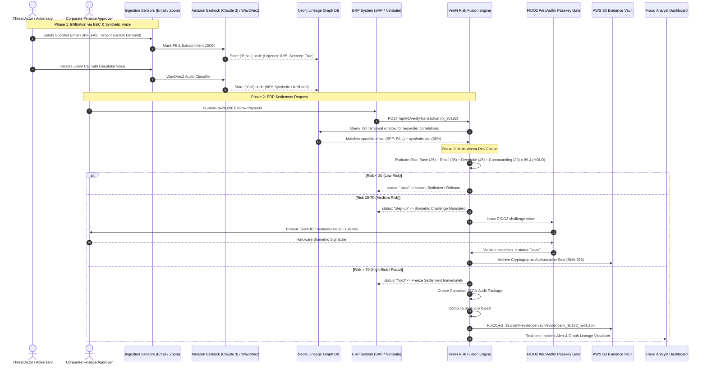

# VeriFi AI — System Architecture & Data Flow Specification

> **Comprehensive architectural blueprint for the VeriFi AI Transaction-Authorization Layer, detailing all sensor ingestion channels, AI/ML pipelines, Neo4j temporal graph lineage, risk fusion decision trees, FIDO2 WebAuthn passkey verification, and AWS S3 cryptographic evidence sealing.**

---

## 1. System Architecture Diagram

```mermaid
flowchart TB
    %% =========================================================================
    %% SUBGRAPH 1: INGESTION SENSORS
    %% =========================================================================
    subgraph SENSORS ["1. Multimodal Communication Sensors"]
        direction TB
        E1["Corporate Email Ingress<br/>(Exchange / Gmail API)"]
        A1["Zoom / Telephony Bot Stream<br/>(Live Meeting Audio / SIP)"]
        
        E_PAYLOAD["Email Ingestion Payload<br/>• Headers: SPF, DKIM<br/>• Sender, Recipient<br/>• Subject, Raw Body"]
        A_PAYLOAD["Audio Ingestion Payload<br/>• Multipart .wav / .mp3<br/>• Caller Identity<br/>• Target Identity"]

        E1 --> E_PAYLOAD
        A1 --> A_PAYLOAD
    end

    %% =========================================================================
    %% SUBGRAPH 2: FASTAPI SENSOR API & AI ENGINES
    %% =========================================================================
    subgraph BACKEND_AI ["2. AI & Sensing Pipeline (FastAPI / Bedrock / Wav2Vec2)"]
        direction TB
        EP_EMAIL["POST /api/v1/sensors/email"]
        EP_AUDIO["POST /api/v1/sensors/audio"]

        E_PAYLOAD -->|"JSON"| EP_EMAIL
        A_PAYLOAD -->|"multipart/form-data"| EP_AUDIO

        PII["PII Redaction Service (Presidio-aligned)<br/>• Masks IBAN: [REDACTED_IBAN]<br/>• Masks Cards: [REDACTED_CARD]<br/>• Masks Financial Sums: [REDACTED_AMOUNT]"]
        
        BEDROCK["Amazon Bedrock (Claude 3 Sonnet)<br/>anthropic.claude-3-sonnet-20240229-v1:0<br/>• Intent Categorization (wire_transfer_request)<br/>• Urgency Score (0.0 - 1.0)<br/>• Financial Action Detected (bool)<br/>• Secrecy Flag Detected (bool)"]
        
        WAV2VEC["HuggingFace Wav2Vec2 Classifier<br/>• Acoustic Phase Discontinuity<br/>• Pitch Jitter & Vocoder Artifacts<br/>• Deepfake Synthetic Probability (0.0 - 1.0)<br/>• Verdict: Authentic / Synthetic"]

        EP_EMAIL --> PII
        PII --> BEDROCK
        EP_AUDIO --> WAV2VEC
    end

    %% =========================================================================
    %% SUBGRAPH 3: NEO4J LINEAGE GRAPH
    %% =========================================================================
    subgraph NEO4J_GRAPH ["3. Neo4j Temporal Lineage Graph"]
        direction TB
        NODE_USER["(:User)<br/>email, name, baseline_risk"]
        NODE_EMAIL["(:Email)<br/>event_id, spf_result, dkim_result,<br/>urgency_score, secrecy_flag, risk_score"]
        NODE_CALL["(:Call)<br/>event_id, caller, deepfake_score,<br/>duration_seconds, risk_score"]
        NODE_PAYMENT["(:Payment)<br/>transaction_id, amount, beneficiary,<br/>iban, risk_score, status"]

        REL_SENT["-[:SENT_TO]->"]
        REL_CALL["-[:CALLED]->"]
        REL_INIT["-[:INITIATED]->"]

        NODE_EMAIL --> REL_SENT --> NODE_USER
        NODE_CALL --> REL_CALL --> NODE_USER
        NODE_USER --> REL_INIT --> NODE_PAYMENT

        CYPHER_QUERY["Temporal Sliding Window Traversal<br/>MATCH (u:User {email: $email})<br/>OPTIONAL MATCH (e:Email)-[:SENT_TO]->(u)<br/>WHERE e.timestamp >= datetime($now - 72h)<br/>OPTIONAL MATCH (c:Call)-[:CALLED]->(u)<br/>WHERE c.timestamp >= datetime($now - 72h)<br/>RETURN emails, calls"]
    end

    BEDROCK -->|"Creates Email Node & Relationship"| NODE_EMAIL
    WAV2VEC -->|"Creates Call Node & Relationship"| NODE_CALL

    %% =========================================================================
    %% SUBGRAPH 4: ERP PAYMENT GATEWAY & RISK FUSION
    %% =========================================================================
    subgraph ERP_GATEWAY ["4. ERP Payment Gate & Risk Fusion Engine"]
        direction TB
        ERP_SRC["ERP Source Systems<br/>(SAP S/4HANA / Oracle NetSuite)"]
        
        EP_VERIFY["POST /api/v1/verify-transaction<br/>• transaction_id, requester_email<br/>• beneficiary_name, beneficiary_iban<br/>• amount, currency, reference"]
        
        ERP_SRC -->|"Payment Settlement Request"| EP_VERIFY

        FUSION_ENGINE["Risk Fusion Engine (Multi-Vector Scoring)<br/>1. Base Amount & Threshold Weighting<br/>2. Beneficiary Anomaly & Offshore IBAN Check<br/>3. 72h Lineage Graph Correlated Sensor Query<br/>4. Compounding Multimodal BEC + Voice Multiplier"]

        EP_VERIFY --> FUSION_ENGINE
        FUSION_ENGINE <-->|"Query 72h Sliding Window"| CYPHER_QUERY
        FUSION_ENGINE -->|"Creates / Updates Payment Node"| NODE_PAYMENT

        DECISION{"Composite Risk Score<br/>Evaluation"}
        FUSION_ENGINE --> DECISION

        BRANCH_PASS["Score < 30<br/>Status: PASS<br/>Nominal Risk Baseline"]
        BRANCH_STEPUP["Score 30 - 70<br/>Status: STEP-UP<br/>Challenge: fido2_passkey<br/>Session: auth_sess_id"]
        BRANCH_HOLD["Score > 70<br/>Status: HOLD<br/>Provable Fraud / BEC Correlation"]

        DECISION -->|"Risk < 30"| BRANCH_PASS
        DECISION -->|"30 <= Risk <= 70"| BRANCH_STEPUP
        DECISION -->|"Risk > 70"| BRANCH_HOLD
    end

    %% =========================================================================
    %% SUBGRAPH 5: FIDO2 WEBAUTHN STEP-UP AUTHENTICATION
    %% =========================================================================
    subgraph WEBAUTHN ["5. FIDO2 / WebAuthn Biometric Step-Up Gate"]
        direction TB
        EP_OPTIONS["POST /api/v1/passkey/generate-options<br/>• user_email, auth_session_id<br/>• Generates Random Challenge Token<br/>• rpId, timeout: 60000ms"]
        
        CLIENT_PROMPT["Frontend Passkey Prompt Modal<br/>(SimpleWebAuthn / Platform Authenticator)"]
        
        HARDWARE_AUTH["Hardware Security Authenticator<br/>• Apple Touch ID / Face ID<br/>• Windows Hello Biometrics<br/>• Physical YubiKey (FIDO2 NFC/USB)"]

        EP_VERIFY_PK["POST /api/v1/passkey/verify<br/>• Validates Public-Key Signature<br/>• Verifies Authenticator Data & User Presence"]

        BRANCH_STEPUP -->|"Trigger Step-Up"| EP_OPTIONS
        EP_OPTIONS --> CLIENT_PROMPT
        CLIENT_PROMPT <--> HARDWARE_AUTH
        CLIENT_PROMPT -->|"Credential Assertion"| EP_VERIFY_PK

        AUTH_RESULT{"Passkey Signature<br/>Valid?"}
        EP_VERIFY_PK --> AUTH_RESULT

        AUTH_SUCCESS["Biometric Verified<br/>Status transitioned to PASS<br/>Payment Released"]
        AUTH_DENIED["Verification Denied / Timeout<br/>Status transitioned to HOLD<br/>Transaction Quarantined"]

        AUTH_RESULT -->|"Signature Valid"| AUTH_SUCCESS
        AUTH_RESULT -->|"Failed / Rejected"| AUTH_DENIED
    end

    %% =========================================================================
    %% SUBGRAPH 6: EVIDENCE SEALING & IMMUTABLE AUDIT VAULT
    %% =========================================================================
    subgraph EVIDENCE_VAULT ["6. Cryptographic Evidence Sealing & Audit Vault"]
        direction TB
        CANONICAL["Canonical JSON Serializer<br/>• Alphabetical Key Sorting<br/>• Standardized ISO-8601 UTC Timestamps<br/>• Escaped Separators: ',', ':'"]
        
        SHA256["SHA-256 Digest Generator (hashlib)<br/>Produces Deterministic 64-character Hex Seal"]

        S3_VAULT["AWS S3 Evidence Vault (Boto3)<br/>Bucket: s3://verifi-evidence-vault/<br/>Key: evidence/{tx_id}_{status}.json<br/>Metadata: x-amz-meta-sha256"]

        LOCAL_VAULT["Local Vault Fallback<br/>(backend/evidence_vault/)"]

        BRANCH_HOLD -->|"Freeze & Seal"| CANONICAL
        AUTH_SUCCESS -->|"Authorize & Seal"| CANONICAL
        AUTH_DENIED -->|"Violation Seal"| CANONICAL

        CANONICAL --> SHA256
        SHA256 --> S3_VAULT
        S3_VAULT -.->|"Fallback if Offline"| LOCAL_VAULT
    end

    %% =========================================================================
    %% SUBGRAPH 7: FRONTEND DASHBOARDS (NEXT.JS APP ROUTER)
    %% =========================================================================
    subgraph FRONTEND ["7. Frontend Portal (Next.js App Router / Tailwind CSS)"]
        direction TB
        PORTAL["VeriFi AI Unified Portal (page.tsx)"]

        VIEW_ERP["ERP Payment Gateway View<br/>• PaymentForm (Presets: $1.2k, $65k, $420k)<br/>• TransactionTable (Status Badges)"]
        
        VIEW_ANALYST["Fraud Analyst Command Center<br/>• LineageGraphView (Neo4j Visualizer)<br/>• RiskScoreMeter (Radial 0-100 Gauge)<br/>• EvidenceSealCard (SHA-256 Copy & S3 URI)"]
        
        VIEW_SENSORS["Multimodal Sensor Lab<br/>• Email Sensor Simulator (SPF/DKIM/Bedrock)<br/>• Zoom Audio Simulator (Wav2Vec2 Score)"]

        PORTAL --> VIEW_ERP
        PORTAL --> VIEW_ANALYST
        PORTAL --> VIEW_SENSORS
        PORTAL -.->|"Displays"| CLIENT_PROMPT

        S3_VAULT -->|"Inspect Evidence Artifacts"| VIEW_ANALYST
        NEO4J_GRAPH -->|"GET /api/v1/audit/lineage/{id}"| VIEW_ANALYST
        BRANCH_PASS -->|"Authorized Settlement"| VIEW_ERP
        AUTH_SUCCESS -->|"Released Settlement"| VIEW_ERP
    end

    %% Styles & Colors
    classDef sensorStyle fill:#1e293b,stroke:#f59e0b,stroke-width:2px,color:#f8fafc;
    classDef aiStyle fill:#0f172a,stroke:#38bdf8,stroke-width:2px,color:#f8fafc;
    classDef graphStyle fill:#1e1b4b,stroke:#818cf8,stroke-width:2px,color:#f8fafc;
    classDef erpStyle fill:#0f172a,stroke:#10b981,stroke-width:2px,color:#f8fafc;
    classDef authStyle fill:#292524,stroke:#eab308,stroke-width:2px,color:#f8fafc;
    classDef vaultStyle fill:#111827,stroke:#ec4899,stroke-width:2px,color:#f8fafc;
    classDef frontStyle fill:#090d16,stroke:#06b6d4,stroke-width:2px,color:#f8fafc;

    class SENSORS sensorStyle;
    class BACKEND_AI aiStyle;
    class NEO4J_GRAPH graphStyle;
    class ERP_GATEWAY erpStyle;
    class WEBAUTHN authStyle;
    class EVIDENCE_VAULT vaultStyle;
    class FRONTEND frontStyle;
```

---

## 2. Sequence Workflow Diagram

---

## 3. Graph Schema Matrix (Neo4j)

| Node Entity | Attributes | Incoming Edges | Outgoing Edges |
| :--- | :--- | :--- | :--- |
| **`(:User)`** | `email`, `name`, `role`, `baseline_risk` | `(:Email)-[:SENT_TO]->`, `(:Call)-[:CALLED]->` | `-[:INITIATED]->(:Payment)` |
| **`(:Email)`** | `event_id`, `sender`, `recipient`, `subject`, `spf_result`, `dkim_result`, `urgency_score`, `risk_score`, `timestamp` | None | `-[:SENT_TO]->(:User)` |
| **`(:Call)`** | `event_id`, `caller`, `target`, `deepfake_score`, `duration_seconds`, `risk_score`, `timestamp` | None | `-[:CALLED]->(:User)` |
| **`(:Payment)`** | `transaction_id`, `amount`, `currency`, `beneficiary_name`, `beneficiary_iban`, `risk_score`, `status`, `timestamp` | `(:User)-[:INITIATED]->` | None |
