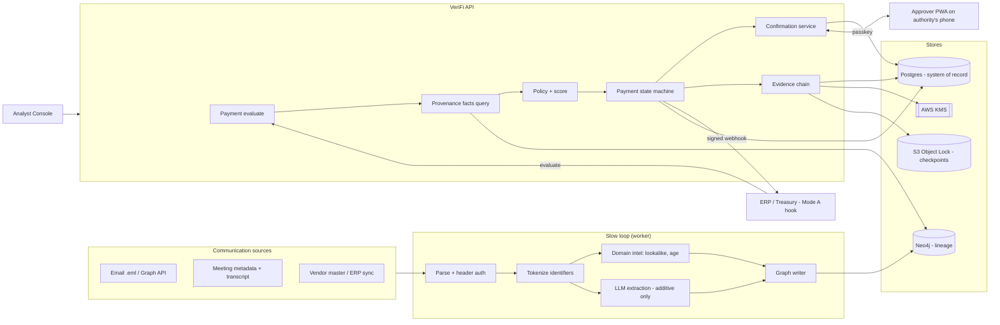

# System Architecture

> **Audience:** engineers · **Owner:** Lead Engineer · **Status:** Target architecture for the rebuild
> Decisions referenced: ADR-002, 007, 009, 011, 013, 015, 016, 018.

## 1. Big picture

VeriFi has two loops that run at different speeds:

- **Slow loop (ingestion, seconds to minutes, async):** communications arrive, get parsed,
  tokenized, enriched (domain intelligence, LLM extraction), and written into the lineage graph.
  All the expensive work happens here.
- **Fast loop (decision, ≤ 300 ms, sync):** a payment arrives for release; VeriFi reads
  precomputed facts about the beneficiary account, applies policy, and returns a tier. If
  confirmation is needed, the confirmation loop starts.



## 2. Components

| Component | Responsibility | Notes |
|---|---|---|
| **API service** (FastAPI) | Public REST API (`09-api-contract.md`), auth, payment evaluation, confirmation endpoints, analyst endpoints | Stateless; all state in Postgres |
| **Worker** | Consumes the Postgres outbox: parsing, tokenization, domain intel, LLM extraction, graph writes, checkpoint signing, incident-pack rendering | Same codebase, different entrypoint |
| **Policy engine** | Pure function: `(facts, payment, policy_yaml) → decision` | No I/O; trivially unit-testable; deterministic (NFR-6) |
| **Provenance service** | Runs the Cypher queries that produce `facts` for a payment | Only component that reads Neo4j on the fast path |
| **Confirmation service** | Confirmer routing, challenge creation, WebAuthn verification, state transitions | `07-confirmation-protocol.md` |
| **Evidence service** | Append records, chain, sign checkpoints, verify | `08-evidence-and-response.md` |
| **Tokenizer** | HMAC tokenization + encrypted vault | Keys from KMS (dev: env) |
| **Web app** (Next.js) | ERP Simulator (`/erp`), Approver PWA (`/approve`), Analyst Console (`/console`) | One deployable; role-gated routes |

## 3. Key flows

### 3.1 Ingest an email (slow loop)
1. `POST /v1/ingest/email` stores the raw `.eml` (encrypted at rest) and enqueues a job → `202`.
2. Worker parses headers; derives SPF/DKIM/DMARC from `Authentication-Results`.
3. Deterministic recognizers find accounts / IFSC / amounts / phones → tokens; raw values go
   to the vault.
4. Domain intel: lookalike check against tenant + vendor domains, RDAP age (cached).
5. LLM extraction on tokenized text → intent, urgency, secrecy, authority claims, payment
   instructions (validated against the JSON schema; invalid → discarded and logged).
6. Graph writer upserts `Domain`, `ExternalIdentity`, `Email`, `BankAccount` (sets
   `first_seen_*` only if new), `AuthorityClaim`, `Meeting` (from invite links), and the edges.

### 3.2 Evaluate a payment (fast loop)
1. ERP calls `POST /v1/payments/evaluate` (HMAC-signed).
2. Upsert the `Payment` row (idempotent) and tokenize the beneficiary account.
3. Provenance service returns facts for that account token (first seen, via what, linked
   messages, meetings, claims, domain facts, velocity counts) with a 150 ms timeout.
   Timeout/failure → `degraded=true` (ADR-007).
4. Policy engine → tier, fired rules, score, contributions.
5. State machine → `RELEASED` (T0) or `PENDING_CONFIRMATION` (T1/T2) and creates the
   confirmation request.
6. Evidence record appended. Response returned.

### 3.3 Confirm (confirmation loop)
See `07-confirmation-protocol.md` §4 for the sequence diagram.

## 4. Trust boundaries

| Boundary | Crossing | Control |
|---|---|---|
| Internet → API | ERP calls, browser calls | TLS; HMAC (services) / passkey session (humans); rate limits |
| API → LLM provider | Tokenized text only | ADR-008 / ADR-009 |
| Ingested content → system | Attacker-authored text and files | Parsed as data; size limits; no rendering of HTML in the console without sanitising |
| Browser/phone → confirmation | Assertions | Server-side WebAuthn verification only |
| Worker/API → evidence | Append-only | DB role for evidence has INSERT only; S3 Object Lock |

## 5. Deployment

| Environment | Shape |
|---|---|
| **Local** | `docker compose up`: `api`, `worker`, `web`, `postgres`, `neo4j`. S3/KMS through LocalStack, *or* the evidence anchor runs in "local-signed" mode (Ed25519 key file), labelled as such. |
| **Demo** (ADR-018) | `web` + `api` + `worker` on one container host on AWS; Postgres (RDS or a managed Postgres); Neo4j AuraDB Free; S3 bucket with Object Lock; KMS key; Bedrock. HTTPS domain; RP ID = domain. Backup path: Cloudflare Tunnel from the demo laptop to the same domain. |
| **Pilot** | Per-customer tenant on shared infrastructure, or a dedicated deployment in the customer's AWS account for regulated customers. Region `ap-south-1` preferred (ADR-017). |

## 6. Target repository layout

```
/backend
  /app
    /api/v1          # routers: ingest, payments, confirmations, console, admin, evidence
    /core            # config, security (HMAC, sessions), db, neo4j, kms, s3
    /domain          # pydantic models, canonical tx, state machine
    /services        # provenance, policy, confirmation, evidence, tokenizer, domain_intel, llm_extract
    /policy          # policy_v1.yaml + loader
    /worker          # job runner + handlers
  /migrations        # alembic
  /tests             # unit, integration, redteam (FM-*), scenarios (S*)
  /fixtures          # demo .eml, transcripts, RDAP/dnstwist fixtures (labelled)
/frontend
  /src/app/(erp)     # ERP Simulator
  /src/app/(approve) # Approver PWA
  /src/app/(console) # Analyst Console + admin
/infra               # docker-compose, deploy scripts
/docs                # this documentation
```

## 7. Failure modes

| Failure | Behaviour |
|---|---|
| Neo4j unavailable / slow | Decision `degraded=true`; R7 raises high-value payments to T1; low-value continue |
| LLM unavailable | Deterministic extraction only; message flagged `llm_pending`; retried later |
| Worker backlog | Ingestion freshness metric; if a message linked to a payment is still unprocessed, `degraded=true` |
| KMS/S3 unavailable | Evidence records still chained in Postgres; checkpoint retried; alert |
| Approver unreachable | Request expires → `HELD_FOR_REVIEW`; escalation to the next authority in the matrix |
| API restart | No state loss (NFR-5) |

## 8. Observability
Structured JSON logs (no raw identifiers), request IDs propagated to the worker, metrics:
evaluate latency, tier distribution, confirmation latency, degraded-decision count, ingestion lag,
LLM validation-failure rate.
