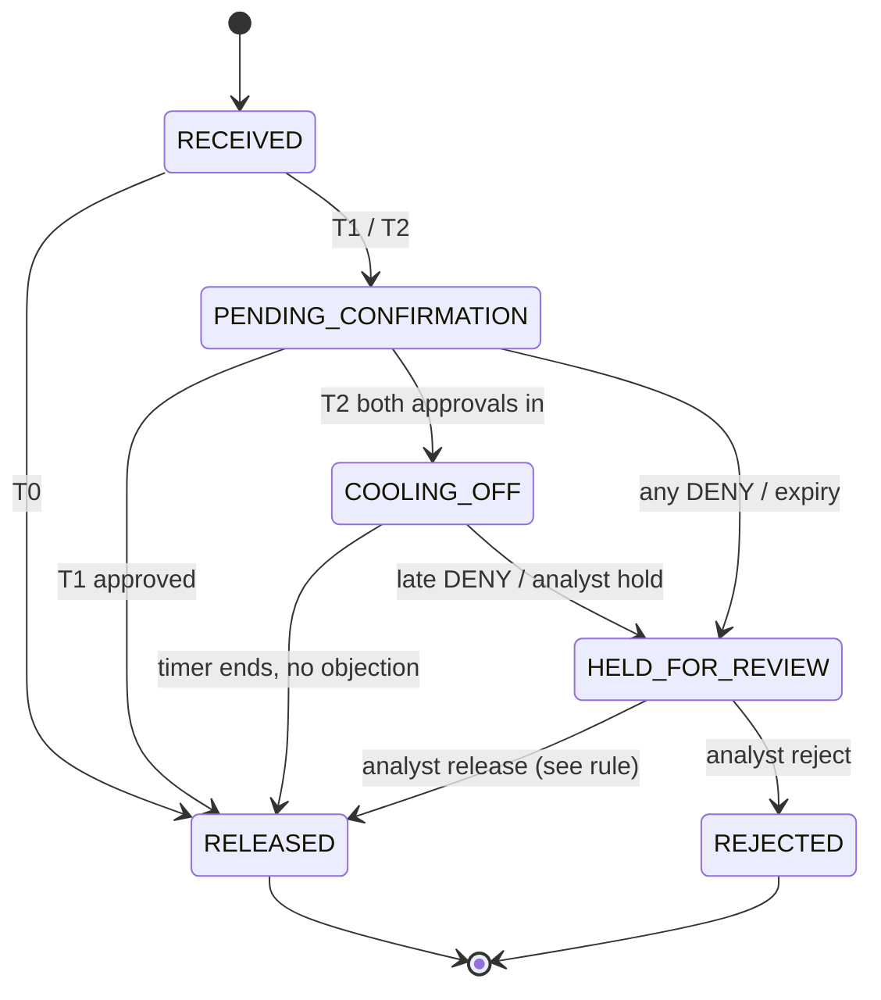
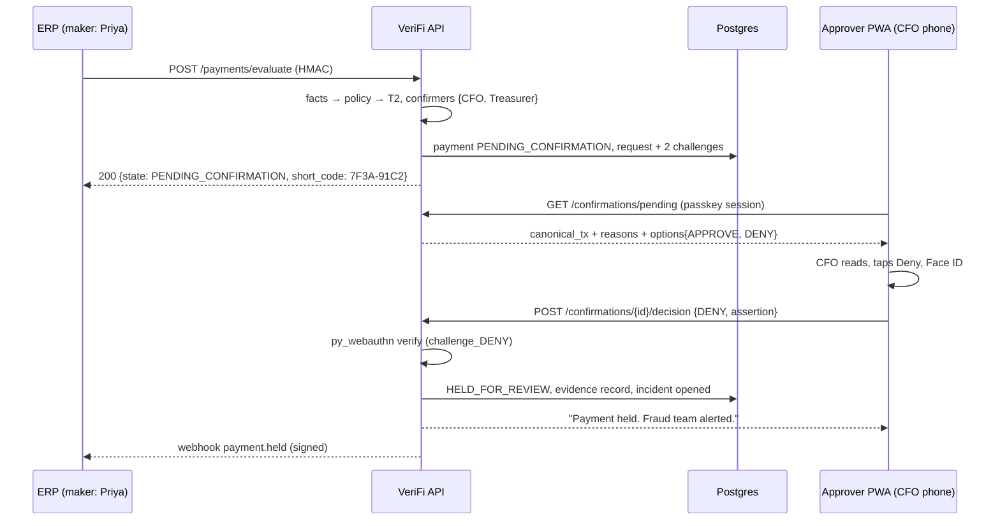

# Authority Confirmation Protocol

> **Audience:** backend + frontend engineers, security reviewers · **Owner:** Confirmation owner · **Status:** Protocol v1
> Decisions referenced: ADR-004 (route to authority), ADR-005 (transaction binding), ADR-006 (tiers), ADR-018 (HTTPS).
>
> This is the security core of VeriFi. If this is wrong, nothing else matters.

## 1. Properties we guarantee

| # | Property | How |
|---|---|---|
| P1 | The confirmer is never the requester | Routing removes the requester (§3) |
| P2 | The confirmer is the person with authority, on their own device | Authority matrix + claimed authority; passkey registered to that person (§3, §6) |
| P3 | The signature covers *this* amount, *this* account, and *this* decision | Transaction- and decision-bound challenge (§4) |
| P4 | What the confirmer sees is what they sign | Prompt rendered from the hashed canonical object (§4.3) |
| P5 | No replay, no reuse across payments | Single-use challenges, server-side binding, expiry, counter check (§5) |
| P6 | Cancel is never Approve | No client-side fallback; no decision until a verified assertion arrives |
| P7 | A decision is non-repudiable and re-verifiable later | Assertion stored in the evidence chain with the public key reference |

## 2. Payment state machine



**Release after a DENY.** If a payment is held because an authority denied it, an analyst
cannot release it alone. Release requires either a fresh APPROVE from the person who denied, or
APPROVE from two authorities senior to them in the matrix. A deceived analyst must not be able
to override the real CFO.

All transitions are performed by one function (`transition(payment, event)`) inside a Postgres
transaction with `SELECT … FOR UPDATE`. Every transition appends an evidence record.

## 3. Routing: who is asked

```python
def confirmers_for(payment, decision, facts, tenant):
    required = authority_matrix(tenant).lookup(
        amount=payment.amount_paise,
        payment_type=payment.type,               # e.g. VENDOR, NEW_BENEFICIARY, INTERCOMPANY
        entity=payment.legal_entity)              # → ordered list of roles, e.g. ["CFO", "Treasurer"]
    people = resolve_roles(required, tenant)       # role → active Person(s) with an enrolled passkey
    people |= {resolve(c) for c in facts.authority_claims if c.resolved}   # add-only (ADR-009)
    people -= {payment.requester}                  # P1
    people -= {p for p in people if not p.has_active_passkey}
    if not people:
        people = {tenant.fallback_authority}       # escalate; never empty, never the requester
    needed = 2 if decision.tier == "T2" else 1
    return people, needed
```

- **T1:** any one person in the set approves → released. Any one DENY → held.
- **T2:** two **distinct** people approve, at least one of whom holds a role from the matrix → cooling-off
  timer → released. Any DENY → held.
- **R3 vendor callback:** the prompt includes a mandatory step: "Call {vendor} on {vendor-master
  number, partially masked}. Do **not** use any number in the email." The confirmer ticks a
  confirmation (recorded as part of the approved decision payload) before the passkey prompt.
- **Delegation:** a person can register a time-bounded delegate in the matrix (e.g. while
  travelling). Delegation changes are evidence events and notify the delegator.
- **Expiry:** T1 30 min, T2 60 min (policy file). On expiry → `HELD_FOR_REVIEW`, analyst notified.

## 4. Transaction binding

### 4.1 Canonical transaction object
```json
{
  "v": 1,
  "tenant_id": "t_arup_demo",
  "payment_id": "pay_01JA…",
  "amount_paise": 5000000000,
  "currency": "INR",
  "beneficiary": {"name": "Meridian Advisory LLP", "acct_token": "ACCT_9f3a1c27b0", "last4": "7812", "ifsc": "HDFC0001234"},
  "requester": {"person_id": "p_priya", "name": "Priya Sharma"},
  "reason_codes": ["R2", "R4"],
  "policy_version": "2026.10-v1",
  "request_id": "cr_01JA…",
  "expires_at": "2026-10-09T11:30:00Z"
}
```
Serialised with **RFC 8785 JSON Canonicalization (JCS)** so the same object always gives the same bytes.

### 4.2 Challenges
For each confirmation request the server creates a 32-byte random `nonce` and two challenges:
```
challenge_APPROVE = SHA-256( JCS(canonical_tx) ‖ "APPROVE" ‖ nonce )
challenge_DENY    = SHA-256( JCS(canonical_tx) ‖ "DENY"    ‖ nonce )
```
Both are stored server-side with the request (status `OPEN`). The client receives two WebAuthn
option sets (`allowCredentials` = the confirmer's own credential IDs, `userVerification: "required"`).
Pressing Approve signs `challenge_APPROVE`; pressing Deny signs `challenge_DENY`. **The decision
is inside the signature.**

### 4.3 What the confirmer sees (rendered from `canonical_tx`)
```
VeriFi · Confirmation requested from you
──────────────────────────────────────
₹5,00,00,000  →  Meridian Advisory LLP
A/c ••••7812 · HDFC0001234
Requested by Priya Sharma (Accounts Payable)

Why you're being asked
• This account first appeared 2 hours ago in an email from arup-group.co
  — a domain registered 4 days ago that imitates arup.com.
• In a Zoom call, an external participant was shown as "Rajesh Mehta (CFO)".

Did YOU instruct this payment?
[ Deny — I did not ask for this ]   [ Approve ]
```
The amount uses Indian grouping. The reason text comes from `rules_fired[].reason`.
Short code `7F3A-91C2` (first 8 hex characters of `SHA-256(JCS(canonical_tx))`) is shown on the
phone and in the ERP Simulator, so both screens visibly refer to the same transaction.

## 5. Verification (server)

On `POST /v1/confirmations/{request_id}/decision` with `{decision, assertion}`:
1. Load the request `FOR UPDATE`; it must be `OPEN` and not expired.
2. Look up the credential by `assertion.rawId`; it must belong to a person in the confirmer set
   who has not already decided on this request.
3. `py_webauthn.verify_authentication_response(...)` with
   `expected_challenge = challenge_<decision>`, `expected_rp_id = RP_ID`,
   `expected_origin = ORIGIN`, the stored public key and sign count,
   `require_user_verification = True`.
4. Signature-counter check: if both stored and new counters are non-zero, the new counter must be
   greater (synced passkeys may always report 0; that is allowed).
5. Mark this person's decision used (the challenge cannot be used again); update the stored counter.
6. Append an evidence record containing `canonical_tx`, `decision`, `nonce`, and the raw assertion
   (`authenticatorData`, `clientDataJSON`, `signature`, `credentialId`).
7. Apply the state transition (§2). Fire the signed webhook to the ERP.

**The client never sends a payment ID to this endpoint.** The request ID maps to exactly one
payment on the server. This closes the v0 "session for A releases B" hole.

## 6. Enrollment (the weakest link, so it is designed carefully)
1. An admin creates a one-time enrollment link for a person (15-minute TTL, single use).
2. The person opens it on **their own phone**, authenticates with the tenant's identity provider
   (MVP: an emailed one-time code), and registers a passkey (`residentKey: "required"`,
   `userVerification: "required"`).
3. Enrollment is an evidence event. The person is notified on all existing channels ("A new
   VeriFi passkey was added to your account").
4. Removing or replacing a passkey for an authority requires two admins.
5. MVP: attestation `none`. Pilot option: require device attestation for authority roles.

## 7. Sequence



## 8. Roadmap
- **Web Push** notifications to the PWA (pilot); SMS/WhatsApp messages carry only a link, never transaction details.
- **Secure Payment Confirmation** where browsers support it, so the browser itself renders the amount and payee.
- **Device attestation** for authority roles in regulated tenants.
